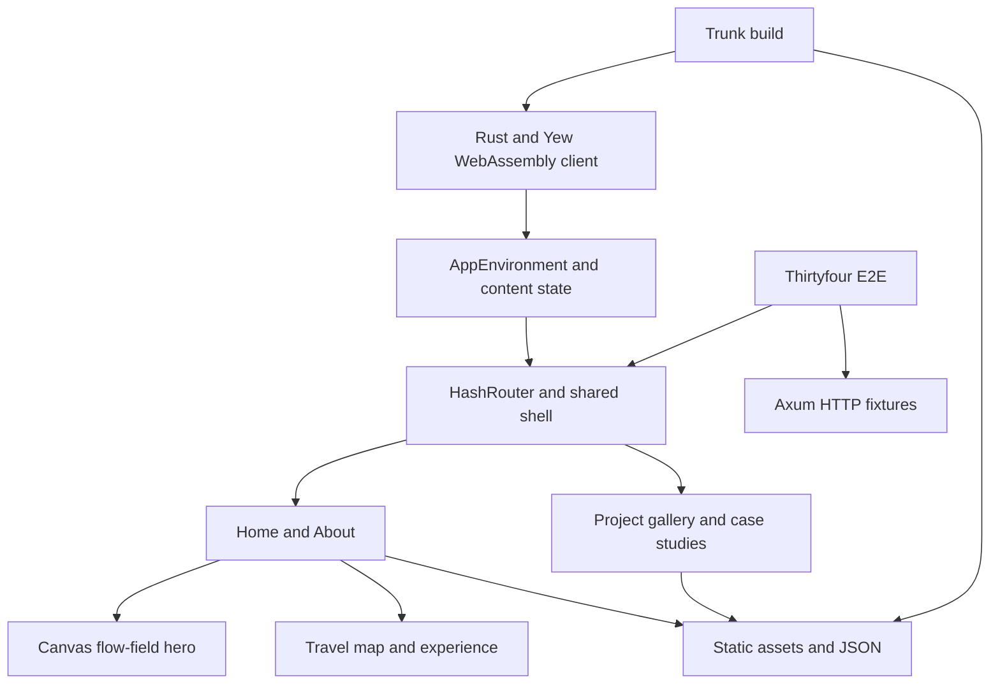

# Józef Podlecki - Portfolio

[](crates/web/Cargo.toml)
[](crates/web/Cargo.toml)
[](crates/web/Trunk.toml)
[](https://github.com/Jozefpodlecki/Jozefpodlecki.github.io/actions/workflows/deploy.yml)

A personal software-engineering portfolio built with Rust, Yew, WebAssembly, Tailwind CSS and Trunk. The site presents real project case studies, professional experience and an interactive travel map. Public content lives in JSON so it can be edited independently from the components.

## Get started

Install [Rust](https://rustup.rs/), the WebAssembly target, [Trunk](https://trunkrs.dev/) and [cargo-make](https://github.com/sagiegurari/cargo-make):

```powershell
rustup target add wasm32-unknown-unknown
cargo install trunk cargo-make
cargo make dev
```

Open <http://127.0.0.1:1420/>. Run commands from the repository root unless indicated otherwise. Trunk downloads the configured Tailwind tooling; no Node.js or npm pipeline is required.

## Commands

| Command | Purpose |
| --- | --- |
| `cargo make dev` | Start Trunk with live rebuilding |
| `cargo make build` | Build the local site into `dist/` |
| `cargo make release` | Build an optimized production distribution |
| `cargo make verify` | Rust formatting, workspace checks, Clippy and browser-free tests |
| `cargo make e2e` | Build `dist/`, then run browser and HTTP-fixture E2E tests |
| `cargo make screenshots` | Capture browser screenshots, with optional approved-baseline comparison |

The E2E suite requires Chrome or Chromium and uses Thirtyfour's managed ChromeDriver. Ordinary browser tests start their own Trunk server; Axum fixture tests use the built `dist/` directory.

## Architecture



`crates/web/` contains the browser application. `crates/e2e/` contains the Rust test harness, fixtures and integration tests. Styling uses Tailwind utilities with a small theme and visual-effects stylesheet. The homepage's right-side Canvas 2D flow field respects reduced-motion preferences.

## Editing content

Update JSON in [`crates/web/public/data/`](crates/web/public/data/) for the biography, experience, projects and travel history. Local project artwork is under `crates/web/public/images/`. The public CV is copied from `crates/web/public/` during the build. Check that any CV you publish contains only contact details you intend to make public.

## Documentation

- [Development](docs/DEVELOPMENT.md) - setup, commands and troubleshooting
- [Architecture](docs/ARCHITECTURE.md) - runtime and module boundaries
- [Content](docs/CONTENT.md) - runtime JSON and public assets
- [E2E](docs/E2E.md) - fixtures, accessibility journeys and visual baselines
- [Deployment](docs/DEPLOYMENT.md) - GitHub Pages workflow and checks
- [SEO](docs/SEO.md) - social metadata, canonical URL and crawler limitations
- [Documentation index](docs/README.md) - all reference guides
